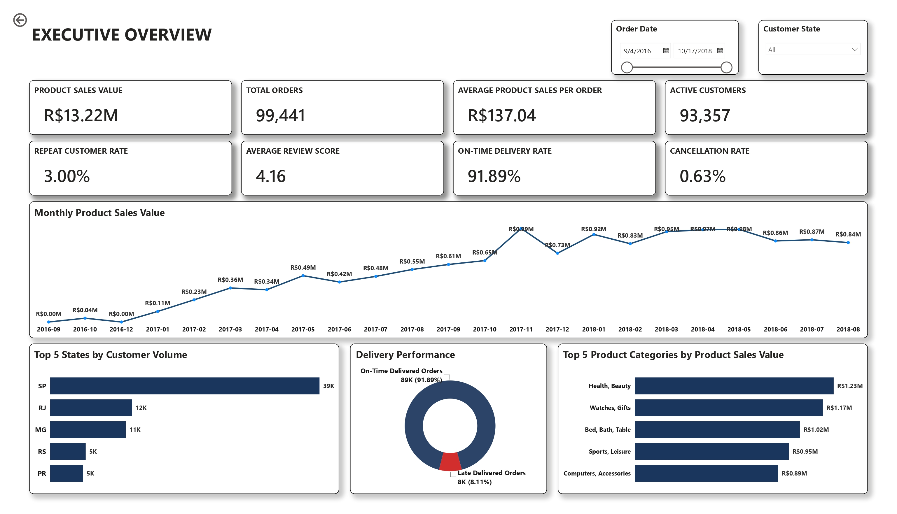
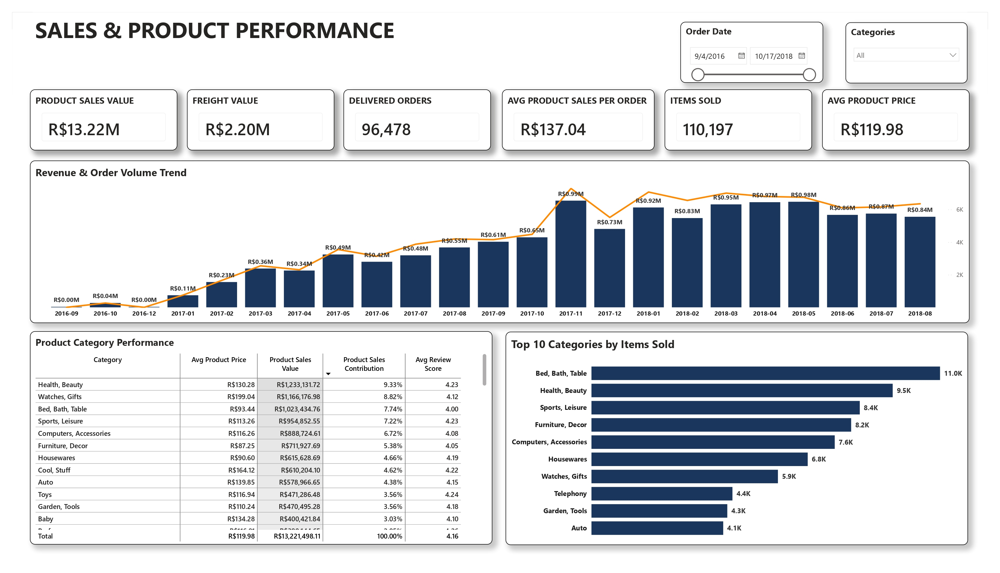
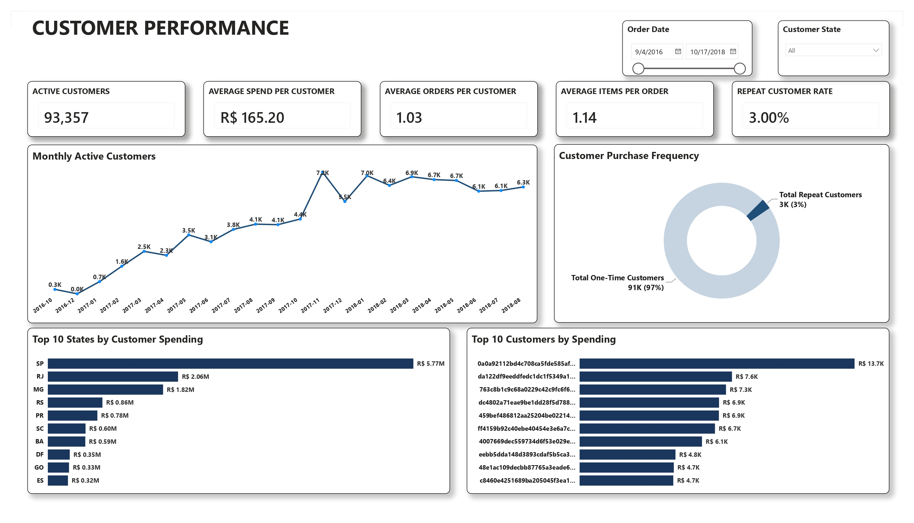
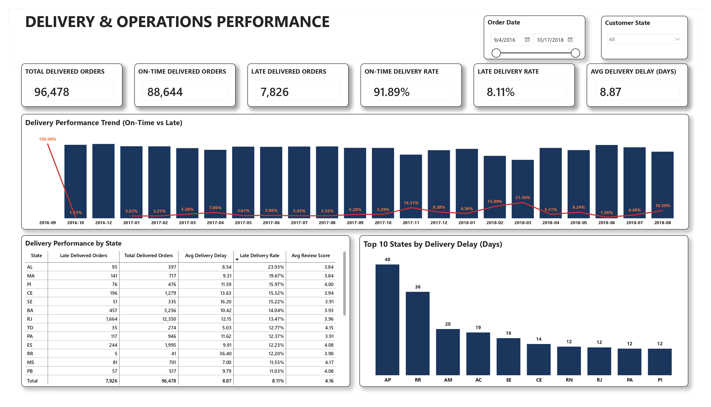
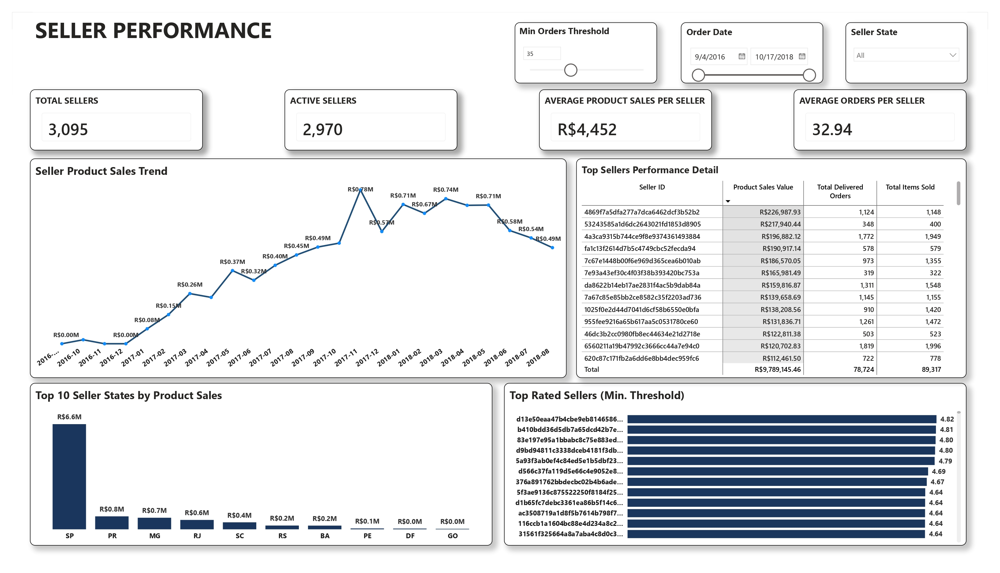
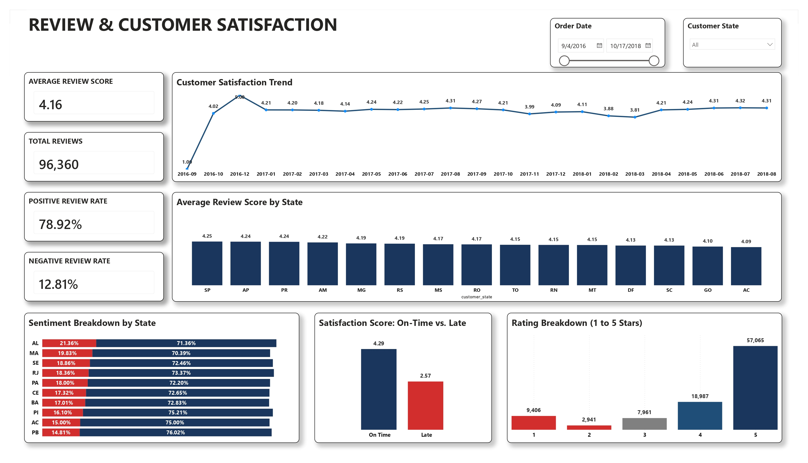

# Olist E-Commerce Analytics

Proyek business intelligence yang menganalisis data transaksi e-commerce Brazil menggunakan SQL (MySQL) dan Microsoft Power BI, mulai dari validasi data hingga dashboard interaktif 6 halaman.

## Project Overview

Proyek ini menganalisis Product Sales, perilaku pelanggan, performa pengiriman, kontribusi seller, dan kepuasan pelanggan untuk mengevaluasi performa marketplace. Data divalidasi dan dibersihkan dengan SQL, lalu dimodelkan dan dianalisis di Power BI menggunakan DAX measures dan visualisasi interaktif.

## Business Problem

Olist membutuhkan insight mengenai performa marketplace untuk menjawab:

- Bagaimana Product Sales berkembang dari waktu ke waktu?
- Produk dan kategori mana yang memberikan kontribusi terbesar?
- Bagaimana performa pelanggan dan seller?
- Seberapa baik performa pengiriman?
- Bagaimana kepuasan pelanggan bervariasi berdasarkan state dan performa pengiriman?

## Dataset

**Olist Brazilian E-Commerce Dataset** (Kaggle): dataset relasional berisi data customers, orders, order items, payments, reviews, products, sellers, dan geolocation. Periode analisis: September 2016 - Oktober 2018, dengan 99.441 order.

## Key Metrics

| Metrik | Nilai |
|---|---|
| Product Sales Value | R$13,22 juta |
| Total Orders | 99.441 |
| Active Customers | 93.357 |
| Average Review Score | 4,16 |
| On-Time Delivery Rate | 91,89% |
| Repeat Customer Rate | 3,00% |

## Tools & Technologies

- **MySQL**: validasi data, data quality checks, cleaning, dan analytical queries
- **Microsoft Power BI**: data modeling, DAX measures, dan dashboard
- **Microsoft Excel**: inspeksi dan validasi data pendukung

## Analytical Workflow

**Source Data → SQL Validation & Cleaning → Power BI Data Modeling → DAX Analysis → Dashboard Development → Business Insights**

## Dashboard

### 1. Executive Overview
Ringkasan performa bisnis secara keseluruhan.

### 2. Sales & Product
Performa penjualan dan kategori produk.

### 3. Customer Performance
Kontribusi dan perilaku pelanggan.

### 4. Delivery & Operations
Performa pengiriman dan operasional.

### 5. Seller Performance
Aktivitas dan kontribusi seller.

### 6. Review & Customer Satisfaction
Ulasan dan kepuasan pelanggan.

## Key Insights

- **Pengiriman:** 91,89% delivered orders tiba tepat waktu, sedangkan 8,11% (7.826 order) terlambat.
- **Keterlambatan dan kepuasan:** Skor review order terlambat 2,57, dibanding 4,29 untuk order tepat waktu. Sejak 2017, bulan dengan late rate tertinggi (Mar 2018: 21,36%) juga memiliki skor review terendah (3,81).
- **Variasi antar-state:** Late rate tertinggi ada di AL (23,93%) dan MA (19,67%), yang juga memiliki skor review terendah (3,84), sedangkan SP tertinggi (4,25). RJ memiliki order terlambat terbanyak (1.664).
- **Retensi rendah:** Repeat customer rate hanya 3% (97% pelanggan membeli sekali).
- **Konsentrasi seller:** 13 seller teratas menyumbang sekitar R$2,11 juta (±16% product sales), padahal hanya 0,4% dari 3.095 seller.
- **Kategori:** Health & Beauty adalah kategori terbesar (9,33%, review 4,23). Bed, Bath, Table paling banyak terjual (11,0K item) tetapi review-nya terendah di antara kategori teratas (4,00).

## Business Recommendations

- **Logistik:** Prioritaskan wilayah dengan late rate tinggi (AL, MA) dan volume terlambat terbesar (RJ), serta siapkan kapasitas sebelum puncak musiman, karena late rate naik saat penjualan memuncak (Nov 2017).
- **Retensi:** Rancang program pembelian ulang (voucher atau email follow-up) untuk pelanggan dengan review 4-5. Sebagai gambaran dampak, setiap kenaikan 1 poin persentase repeat rate (dari 3% saat ini) setara dengan sekitar 930 (1% × 93.357) pelanggan yang kembali membeli. Pantau repeat rate setiap bulan.
- **Seller:** Beri eksposur kepada seller berating tinggi, yang berbeda dari seller dengan penjualan tertinggi. Tambahkan seller di luar SP untuk memperpendek jarak kirim.
- **Kategori:** Telusuri ulasan negatif Bed, Bath, Table untuk mencari penyebab rating 4,00.

## Limitations

Dashboard ini adalah alat analisis deskriptif dan diagnostik berbasis data historis 2016-2018, sehingga tidak dapat memprediksi kinerja masa depan. Hubungan antar-metrik, seperti keterlambatan pengiriman dan skor review, bersifat korelasi dan tidak membuktikan sebab-akibat. Dataset tidak memuat biaya atau margin, jadi analisis berfokus pada penjualan (product sales), bukan profitabilitas.

## Project Files

- [Dashboard](dashboard/): Power BI dashboard dan informasi akses
- [Documentation](documentation/): dokumentasi lengkap proyek
- [Screenshot](screenshot/): preview enam halaman dashboard
- [SQL Scripts](sql/): script validation, cleaning, EDA, dan business analysis
